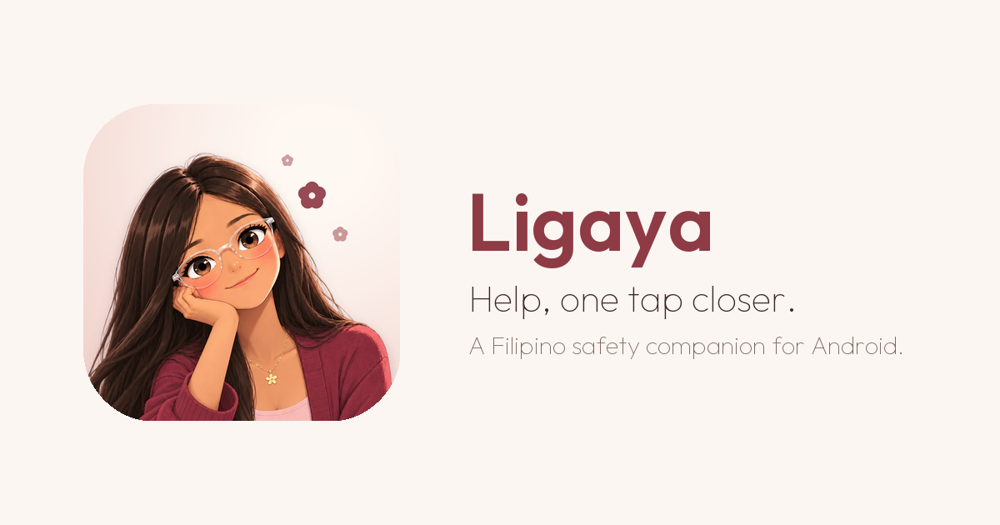
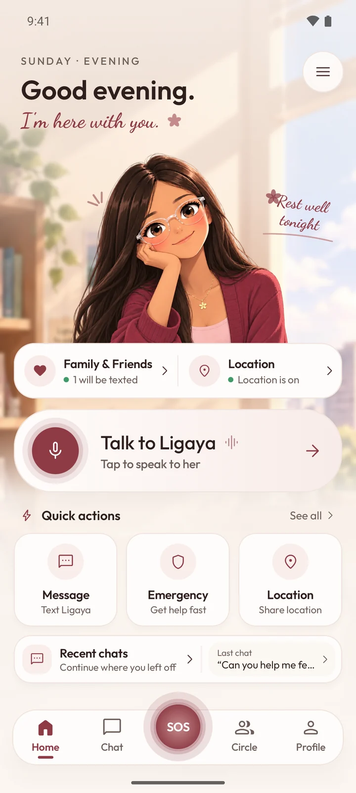
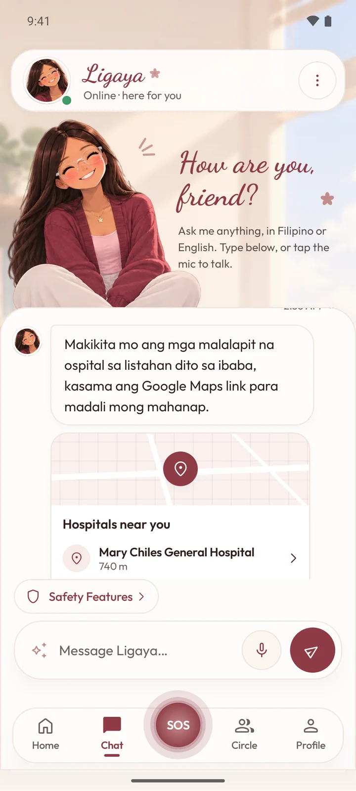
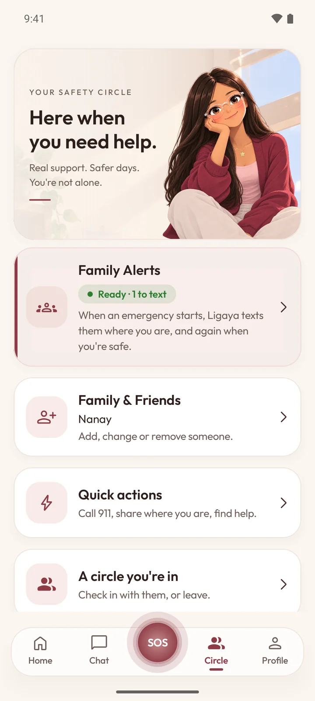

  

  <a href="https://ligaya-app.vercel.app/"><b>Website</b></a> &nbsp;|&nbsp;
  <a href="https://ligaya-app.vercel.app/Ligaya.apk?v=8"><b>Download Android APK</b></a> &nbsp;|&nbsp;
  <a href="#flagship-overview"><b>Overview</b></a> &nbsp;|&nbsp;
  <a href="#core-architectural-pillars"><b>Architecture</b></a> &nbsp;|&nbsp;
  <a href="#in-app-experience"><b>Experience</b></a> &nbsp;|&nbsp;
  <a href="#systems-and-projects"><b>Systems & Projects</b></a> &nbsp;|&nbsp;
  <a href="#technologies"><b>Technologies</b></a>

# Sindous

**Software Developer and Systems Architect**

> "Don't bet against me."

---

## Flagship Overview

<table>
  <tr>
    <td width="65%" valign="top">
      <h3>Ligaya — Help, one tap closer.</h3>
      

        <b>A purpose-built Filipino emergency safety companion engineered to eliminate friction between danger and help.</b> 
        Free and open access for everyone, because safety should never be a luxury or hidden behind paywalls.
      

      
<i>"Kaya mo 'to. I'm here with you."</i>

       
      <h4>The Challenge & The Mission</h4>
      

        In an emergency, panic freezes cognitive function. Standard apps demand multiple taps, navigation trees, or reliable high-speed data. Ligaya is built around the realities of the Philippine infrastructure: designed to operate under zero-connectivity conditions, on lower-tier Android hardware, and with zero latency when seconds determine survival.
      

       
      

        <a href="https://ligaya-app.vercel.app/"><b>Visit Web Portal -></b></a> &nbsp;&nbsp;
        <a href="https://ligaya-app.vercel.app/Ligaya.apk?v=8"><b>Download APK (v8) -></b></a>
      

       
      
<b>Target Platform:</b> Android 8.0+ (Oreo to Android 15) &bull; Free release

    </td>
    <td width="35%" align="center" valign="middle">
      
        
      
       
      <b>Ligaya for Android</b>
    </td>
  </tr>
</table>

---

## Core Architectural Pillars

<table>
  <tr>
    <td width="50%" valign="top">
      <h4>1. Panic-Proof Emergency SOS Engine</h4>
      

        A deterministic state machine that eliminates hesitation during acute crises.
      

      <ul>
        <li><b>Two-Tap Trigger:</b> Direct handoff to the native system dialer with 911 primed immediately.</li>
        <li><b>Safety Buffer:</b> A 5-second cancelable countdown prevents false alarms without adding friction.</li>
        <li><b>One-Hand Reachability:</b> Interface components adhere to strict ergonomic thumb zones for high-stress operation.</li>
      </ul>
      
<b>Module:</b> <code>core-emergency-engine</code>

    </td>
    <td width="50%" valign="top">
      <h4>2. Zero-Data Cellular Location Broadcast</h4>
      

        Reliable emergency messaging that functions even when mobile data is dead.
      

      <ul>
        <li><b>Hardware SMS Fallback:</b> Automatically transmits GPS coordinates via cellular telephony when 4G/5G drops.</li>
        <li><b>Reverse Geocoding:</b> Encodes nearest street names and map coordinates directly into payload messages.</li>
        <li><b>Circle Notification:</b> Simultaneous multi-contact SMS broadcast dispatched directly from the device.</li>
      </ul>
      
<b>Module:</b> <code>core-telephony</code> &bull; <code>core-location</code>

    </td>
  </tr>
  <tr>
    <td width="50%" valign="top">
      <h4>3. Live Proximity Infrastructure Radar</h4>
      

        Immediate awareness of emergency response infrastructure without manual searching.
      

      <ul>
        <li><b>Critical Facilities:</b> Locates nearest hospitals, trauma clinics, PNP precincts, and BFP stations.</li>
        <li><b>Offline Caching:</b> Pre-indexes regional emergency facility datasets for offline querying.</li>
        <li><b>One-Touch Route:</b> Launches direct turn-by-turn routing to the nearest active triage unit.</li>
      </ul>
      
<b>Module:</b> <code>core-places</code>

    </td>
    <td width="50%" valign="top">
      <h4>4. Bilingual De-escalation Companion</h4>
      

        Empathetic, local conversational intelligence designed to mitigate panic attacks.
      

      <ul>
        <li><b>Tagalog & English:</b> Natural bilingual interaction tuned for conversational comfort and grounding.</li>
        <li><b>On-Device Voice Pipeline:</b> Low-latency speech recognition (STT) and synthesized voice feedback (TTS).</li>
        <li><b>Crisis Calming Protocols:</b> Evidence-based grounding techniques to stabilize breathing while help arrives.</li>
      </ul>
      
<b>Module:</b> <code>core-ai</code> &bull; <code>core-voice</code>

    </td>
  </tr>
</table>

---

## In-App Experience

<table>
  <tr>
    <td width="33%" align="center" valign="top">
      
        
      <b>Home & Instant SOS</b>
      

        High-visibility emergency dispatch controls, direct 911 dialer priming, and one-tap family notification broadcast.
      

    </td>
    <td width="33%" align="center" valign="top">
      
        
      <b>Empathetic Companion</b>
      

        Bilingual conversational agent providing grounding, calm dialogue, and structured emergency guidance in Filipino and English.
      

    </td>
    <td width="33%" align="center" valign="top">
      
        
      <b>Radar & Ligaya+ Circle</b>
      

        Real-time proximity mapping for emergency medical facilities and a daily check-in loop for up to 5 trusted family members.
      

    </td>
  </tr>
</table>

---

## Technical Architecture & Optimization

<table>
  <tr>
    <td width="50%" valign="top">
      <h4>Engineering for Local Hardware Realities</h4>
      

        Engineered specifically for the hardware profile of the Philippine market, prioritizing battery longevity and low memory footprints:
      

      <ul>
        <li><b>Low-Tier Device Profiling:</b> Verified on low-memory Android hardware to eliminate process killing during emergencies.</li>
        <li><b>Conservative Battery Drain:</b> Background location listeners throttled through battery-conscious geofencing APIs.</li>
        <li><b>Cold Start Performance:</b> App startup streamlined to sub-second readiness for instantaneous crisis access.</li>
      </ul>
    </td>
    <td width="50%" valign="top">
      <h4>Modular Clean Architecture</h4>
      

        Strict separation of concerns across 20+ specialized Gradle modules:
      

      <ul>
        <li><b>Frontend:</b> 100% Jetpack Compose with custom design system for high-contrast accessibility.</li>
        <li><b>Concurrency:</b> Kotlin Coroutines and StateFlow for deterministic asynchronous pipeline execution.</li>
        <li><b>Web Ecosystem:</b> Companion web portal and distribution pipeline built on Next.js, TypeScript, and Vercel.</li>
      </ul>
    </td>
  </tr>
</table>

---

## Systems and Projects

<table>
  <tr>
    <td width="50%" valign="top">
      <h3><a href="https://github.com/sindoussss/synapse">SYNAPSE</a></h3>
      
<b>Autonomous Web Development System</b> &bull; <code>TypeScript</code>

      

        Evidence-driven autonomous software engineering engine with verifiable milestone execution, audit-ready payment/session remediation, and full client lifecycle automation.
      

      
<a href="https://github.com/sindoussss/synapse">View Repository -></a>

    </td>
    <td width="50%" valign="top">
      <h3><a href="https://github.com/sindoussss/science-ai">Science AI</a></h3>
      
<b>Local Computational Research Engine</b> &bull; <code>Python</code>

      

        Fully local, chat-first scientific computing framework. Local models served through Ollama directing exact deterministic tools (SymPy, NumPy, SciPy) across an immutable proof graph.
      

      
<a href="https://github.com/sindoussss/science-ai">View Repository -></a>

    </td>
  </tr>
  <tr>
    <td width="50%" valign="top">
      <h3>PH Economic Pressure AI</h3>
      
<b>Macroeconomic Intelligence Pipeline</b> &bull; <code>Python</code>

      

        Data intelligence pipeline measuring socioeconomic strain, inflation vulnerability, and household purchasing power across Philippine regions.
      

    </td>
    <td width="50%" valign="top">
      <h3>MariaClara</h3>
      
<b>Offline Local Intelligence</b> &bull; <code>Python</code>

      

        Privacy-preserving personal cognitive assistant engineered for local edge execution with zero latency and zero data leakage.
      

    </td>
  </tr>
</table>

---

## Technologies

<table>
  <tr>
    <td width="25%" valign="top">
      <b>Languages</b>
      <ul>
        <li>Kotlin</li>
        <li>Python</li>
        <li>TypeScript</li>
        <li>JavaScript</li>
        <li>SQL</li>
      </ul>
    </td>
    <td width="25%" valign="top">
      <b>Mobile & Frontend</b>
      <ul>
        <li>Android SDK</li>
        <li>Jetpack Compose</li>
        <li>Next.js</li>
        <li>React</li>
        <li>Tailwind CSS</li>
      </ul>
    </td>
    <td width="25%" valign="top">
      <b>AI & Mathematics</b>
      <ul>
        <li>Ollama (Local LLMs)</li>
        <li>PyTorch</li>
        <li>SymPy</li>
        <li>NumPy</li>
        <li>SciPy</li>
      </ul>
    </td>
    <td width="25%" valign="top">
      <b>Infrastructure</b>
      <ul>
        <li>Supabase</li>
        <li>Git & GitHub</li>
        <li>Linux</li>
        <li>Docker</li>
        <li>Vercel</li>
      </ul>
    </td>
  </tr>
</table>

---

  

    <a href="https://github.com/sindoussss"><b>sindoussss</b></a> &bull;
    <a href="https://ligaya-app.vercel.app/">Ligaya Safety Companion</a> &bull;
    <a href="https://github.com/sindoussss/synapse">SYNAPSE</a> &bull;
    <a href="https://github.com/sindoussss/science-ai">Science AI</a>
  

  "Don't bet against me."

